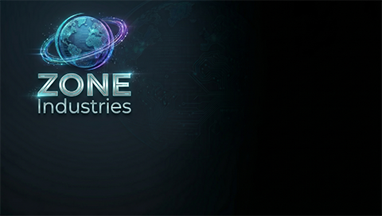

# Nextion Sim-Racing Telemetry HUD & Stream Deck Controller

Antarmuka layar sentuh **Nextion HMI** kustom yang menggabungkan **Dashboard Telemetri Formula 1** secara *real-time* (melalui **SimHub**) dengan **Stream Deck Audio Controller** berbasis **Python Serial Broker** untuk mengatur volume dan status mikrofon **Discord** tanpa mengganggu sesi balapan.

---

## Pratinjau Antarmuka (UI Pages)

| Halaman Utama (Launcher) | Dashboard Telemetri F1 | Kontrol Audio Discord |
| :---: | :---: | :---: |
|  |  |  |

---

## Fitur & Arsitektur Sistem

### 1. SimHub Telemetry Script (`F1Telemetry.js`)
Skrip JavaScript kustom yang memformat data telemetri gim dan mengirimkannya ke objek komponen Nextion dengan manajemen prioritas *frame* agar komunikasi serial tetap responsif:
* **Mode Siaga (*Idle Screen*):** Menampilkan jam digital (dengan indikator titik dua berkedip) serta tanggal saat gim tidak berjalan.
* **Telemetri Prioritas Tinggi (*Real-Time*):** Kecepatan (`SpeedNum`), posisi gigi (`Gear`), persentase & bar energi `ERS` (kalkulasi dari `m_ersStoreEnergy`), `RPM` (`10.000–12.100 RPM` dengan efek kedip *redline*), dan indikator status `DRS` kiri/kanan.
* **Telemetri Prioritas Rendah (Interval ~200 ms):** Nomor lap & posisi balapan, suhu dan sisa keausan keempat ban (`FL, FR, RL, RR`), *Brake Bias* (`BBNum`), *On-Throttle Differential* (`DiffNum`), waktu lap & *session live delta*, sisa bahan bakar & *fuel delta*, serta mode deployment ERS (*Medium, Hotlap, Overtake*).

### 2. Python Serial & Audio Broker (`dashboard_broker.py`)
Layanan latar belakang berbasis Python yang berkomunikasi dua arah dengan Nextion melalui port serial (`115200 bps`) dengan filter *debounce* `300 ms`:
* **Per-App Volume Control (`pycaw`):** Membaca dan mengatur tingkat volume khusus aplikasi `Discord.exe` pada Windows Audio Session dengan kenaikan/penurunan `5%` per tekanan (`B01` / `B02`) serta menyinkronkan angka persentasenya ke `VolPercent.txt` di layar Nextion.
* **Voice Hotkey Macro (`pyautogui`):** Mengeksekusi pintasan *Mic Mute/Unmute* (`Ctrl + Shift + M` via perintah `B03`) dan *Deafen* (`Ctrl + Shift + D` via perintah `B04`).

### 3. Nextion HMI Interface (`F1.HMI` & `F1.tft`)
* **Launcher & Navigasi (`Halaman_Utama`):** Antarmuka sentuh multi-halaman dengan umpan balik tombol *normal* dan *pressed state* untuk navigasi mode gim (*F1, ETS2, Assetto Corsa, WRC*), panel **Discord**, dan **OBS**.

---

## Struktur Repository

```text
nextion-simracing-telemetry-hud/
├── Font/                         # File font Nextion (.zi) untuk kompilasi ulang UI
├── Logo/                         # Aset ikon tombol (Normal & Pressed state)
├── F1.HMI                        # File source project Nextion Editor
├── F1.tft                        # Firmware tampilan Nextion hasil compile (siap flash ke SD Card)
├── F1Telemetry.js                # Skrip pemetaan & optimasi telemetri SimHub
├── dashboard_broker.py           # Skrip Python serial bridge & kontrol volume/hotkey Discord
├── requirements.txt              # Daftar dependensi Python
├── Halaman_Utama*.png            # Desain halaman menu utama & navigasi
├── F1 Template *.png             # Desain lapisan UI dashboard F1 (Base, DRS, ERS, RPM)
├── Discord Page.png              # Desain halaman kontrol audio Discord
├── .gitignore
└── README.md
```

---

## Panduan Instalasi & Penggunaan

1. **Flashing Tampilan ke Layar Nextion:**
   * Salin file **`F1.tft`** ke kartu **microSD** kosong (format FAT32), masukkan ke slot microSD layar Nextion dalam keadaan mati, lalu hubungkan daya `5V` hingga muncul pesan `Update Successed!`.
   * Untuk mengedit tata letak atau komponen UI, buka **`F1.HMI`** di **Nextion Editor** (pastikan font di folder `Font/` sudah terpasang).
2. **Konfigurasi SimHub (`F1Telemetry.js`):**
   * Hubungkan layar Nextion ke PC via modul **USB-to-TTL**.
   * Buka **SimHub** -> **Nextion Display**, arahkan ke port COM yang aktif, dan muat skrip **`F1Telemetry.js`**.
3. **Menjalankan Python Discord Broker (`dashboard_broker.py`):**
   * Instal dependensi yang dibutuhkan:
     ```bash
     pip install -r requirements.txt
     ```
   * Sesuaikan variabel `COM_PORT` di dalam `dashboard_broker.py` (default: `COM5`), lalu jalankan:
     ```bash
     python dashboard_broker.py
     ```